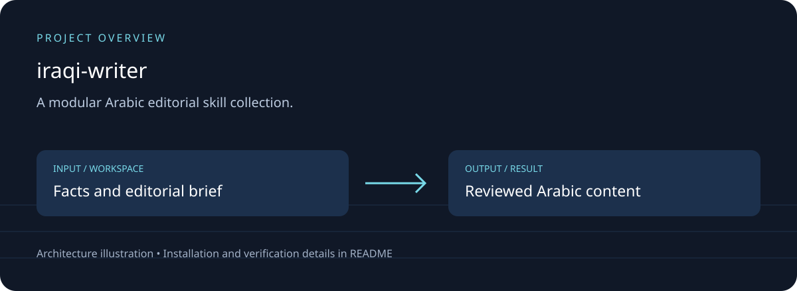

# الكاتب العراقي — Iraqi Writer

## Download, setup and project overview

A modular Arabic editorial skill collection.

Task routing; voice references; research and editing; single-post and carousel workflows.



[Download source ZIP](https://github.com/ahpa5246-lgtm/iraqi-writer/archive/refs/heads/main.zip) · [Changes and branches](https://github.com/ahpa5246-lgtm/iraqi-writer/branches) · [Verification notes](docs/QUALITY_REVIEW.md)

The ZIP contains source code. Installation steps and external runtime requirements are listed below.

```bash
git clone https://github.com/ahpa5246-lgtm/iraqi-writer.git
cd iraqi-writer
```

From the repository directory:

```text
# Add this folder to an Agent Skills-compatible environment.
# Start by reading SKILL.md.
python -m unittest discover -s tests -v
```

The diagram is a project illustration. Test results and runtime limitations are recorded in [the review](docs/QUALITY_REVIEW.md); it is not a production-readiness certification.


مجموعة مهارات تحرير محتوى عربي للمنشورات المفردة، وكاروسيلات إنستغرام، والمحتوى التقني والتصميمي.

**الصوت المعتمد:** عربية واضحة وقريبة من القارئ، مع لمسة عراقية خفيفة حين تخدم الجملة، لا لهجة كثيفة أو استبدال آلي للحروف. النموذج الأسلوبي تحريري ومعلوماتي: عنوان دقيق، شرح مختصر، مثال ملموس، ونهاية مكتملة.

## كيف يعمل الاختيار التلقائي؟

اقرأ [SKILL.md](SKILL.md). يصنّف الوكيل الطلب وفق **ثلاثة محاور مستقلة**: الصيغة (منشور / كاروسيل)، الموضوع (تقني / تصميمي / غير ذلك)، ونوع المهمة (تأليف / إعادة كتابة / تحرير / وصف بصري). ثم يحمل ملفات المهارات ذات الصلة فقط. يمكن دمج مهارتين أو أكثر؛ مثل «كاروسيل تقني» أو «منشور يشرح مبدأ تصميم».

> وجود الملفات على GitHub لا يشغّلها تلقائيًا داخل كل نموذج. يجب إضافة المستودع إلى بيئة تدعم Agent Skills أو توجيه الوكيل لقراءة `SKILL.md` عند بدء المهمة. اختيار المسار يتم عند استخدام هذا المدخل.

## الملفات

- `SKILL.md` — الموجّه الرئيسي واتخاذ القرار.
- `AGENTS.md` — تعليمات للوكلاء العاملين داخل المستودع.
- `skills/single-post/` و`skills/carousel/` — صيغة النشر.
- `skills/technical/` و`skills/design-writing/` — الاختصاص.
- `skills/visual-direction/` — توجيه التصميم عندما يُطلب إعداد تصور بصري.
- `skills/research/` و`skills/editor/` — التحقق والتحرير.
- `references/` — الصوت التحريري، الهوية البصرية، ومعايير الجودة.
- `tests/` — فحوص سلامة الهيكل وروابط الملفات.

## أمثلة للتوجيه

| الطلب | المسار |
| --- | --- |
| «اكتب منشورًا عن موقع يفيد طلاب الهندسة» | single-post + technical + research + editor |
| «حوّل الشرح إلى 6 شرائح» | carousel + technical + editor |
| «منشور يشرح قاعدة 180 درجة» | single-post + design-writing + editor |
| «كاروسيل عن أخطاء اختيار الخط العربي» | carousel + design-writing + editor |
| «صمّم لي تصورًا بصريًا للكاروسيل» | carousel + visual-direction + editor |
| «صحّح لغويًا فقط» | editor فقط، مع الحفاظ على البناء |

لا يفترض هذا المشروع أدوات أو اتصالًا بالإنترنت أو توليد صور. يُنتج النص الجاهز للنشر؛ وإذا طُلب إخراج صور، يستخدم الوكيل أدواته المتاحة صراحةً دون الادعاء بإنتاج ملفات لم ينشئها.

## التحقق محليًا

```bash
python -m unittest discover -s tests -v
```

## المصادر الفكرية

صيغت التعليمات هنا بصورة أصلية، بالاستفادة من مبادئ عامة موثقة في:
- [Social Media Skills](https://github.com/social-media-skills/skills) (MIT): كتابة الكاروسيل، الكابشن، البحث، وتوصيف الصوت.
- [Marketing Skills](https://github.com/coreyhaines31/marketingskills): جولات التدقيق والتحرير.
- [Article Craft](https://github.com/TharunKumarReddyPolu/article-craft) (Apache-2.0): التحقق من الادعاءات وتحسين المقالات.
- [Copywriter Agent](https://github.com/michaelboeding/skills/tree/master/skills/copywriter-agent): فصل عمل العنوان والمتن والدعوة الإجرائية.

لم تُنسخ ملفات تلك المستودعات، ولا تتطلب هذه المهارات أيًا من حزمها البرمجية. راجع التراخيص والمصادر قبل إعادة استخدام نصوص أو ملفات من المشاريع الأصلية.
